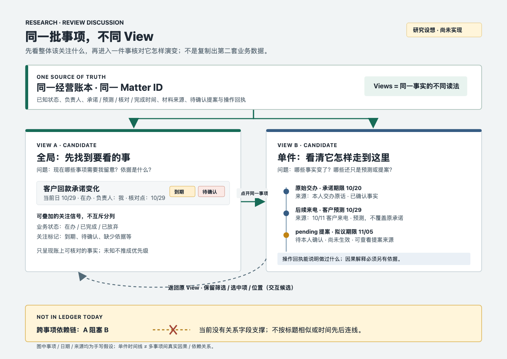

# 首用价值旅程：示例预览、首件契约与耐久验证

> 审阅日期：2026-10-29。范围 = 仓内当前实现、合同、历史现场、隔离的真实模型会话与静态原型；不读取日用 home，不把任一次模型回合当作质量/价值证明。历史事实、当前代码事实、本轮实验观测、推论与未知分别标明；`.tmp/` 原始运行只在列出的隔离目录，不是产品数据。

## REVIEW 结论（开放，不预选实现）

**现有证据不足以把价值感不足归结为一个根因。** 当前把“用户看不出从哪里开始”作为唯一问题会过窄；两次真实隔离模型运行显示，还必须审查“输出能否把事实、本人标准、模型假设和实际执行分开”。本轮最具体的负面信号不是视觉问题，而是报价实验把模型选出的复审日写入持久 `promisedDeadline`，续接实验在发现 proposal 已过期后仍要求用户确认它，并声称会联系客户却无任何外部执行动作。

1. **H1 入口/任务理解：中低强度。** 有历史本人原话和旧现场支持；当前首页已给经营问题和三个示例，历史入口问题也修过。没有当前冷读数据，不能断言仍是首因。
2. **H2 首件价值/可信度：相对聊天差异尚未证实；质量风险已由隔离运行观察到。** 报价同题模型对照中，preset 回答较短、有账本/memo/交付文件；无 preset 回答较长、也给出无出处阈值。preset 另外把无依据日期写成承诺，memo 有算术和条件冲突。一次非盲、无材料对照不能判哪边整体更好，但表明“格式化、持久化”不等同可信或贴合本人标准；这可能直接伤害使用价值。
3. **H3 跨会话接续/闭环：区别机制最具体，用户净收益最未知。** synthetic continuation 正确读对事项与来源，并保留承诺/预测/待确认边界；但它也建议确认已过期日期，并声称要做没有能力/回执的对外动作。当前地板 PASS 不涵盖这两种风险。没有自然跨日业务事项、本人复用或成本收益观察。

**方案尚未裁决。** A（先看手工成果样例）只测 H1 的可见性；B（说清两入口各自交付什么）是承诺一致性，不会修复质量；C（首题至刷新读回的耐久验收）只能增加团队对行为兑现的信心，不直接令用户感知价值；同题盲评与真实跨时观察更直接触及 H2/H3，但需要本人提供任务材料/判断标准并自然产生事项。通用 Projects 已提供历史搜索/项目记忆，故差异不能只叫“记住上下文”；本仓可具体展示的是经营状态、权限、操作回执和来源组织，但其价值仍需和假设误写风险一起验证。所有选项都只是 REVIEW 输入，未授权进入实现。

本轮不声称达到目标用户价值。建议先由本人判读下面两条真实运行中的具体输出和原型，再决定下一步是修可信度/假设隔离、做真人比较，还是调整价值主张；无需预先保留 A+C。

## 当前旅程的事实

### 首页「示例」目前不是成品预览

- **事实：**首页代码把三个字符串定义为“一键示例”，点击时只调用 `setCaptureDraft(example)`；首页提交需用户按 Enter 或点「交给它」，才调用 `deliver(text, 'home')`。见 [one-page-home.ts](../../../../packages/dsh-smart-assistant/src/client/projection/one-page-home.ts#L30-L31)、[one-page-home.ts](../../../../packages/dsh-smart-assistant/src/client/projection/one-page-home.ts#L173-L209)、[one-page-home.ts](../../../../packages/dsh-smart-assistant/src/client/projection/one-page-home.ts#L323-L331)。测试明确证明点示例会填输入且不调用 capture：[one-page-home.spec.ts](../../../../packages/dsh-smart-assistant/tests/client/one-page-home.spec.ts#L237-L243)。所以当前机制已满足“不自动发送”，但没有看到示例对应的成品结果，也没有“看完预览再带入”的路径。
- **事实：**空首页展示“最近哪件事让你拿不准？”和三条示例；空首页首屏 DOM 基线也只记录问句、输入与三示例，没有结果预览：[blank-first-open README](../../../../snapshots/web-face/blank-first-open/README.md#L8-L15)。
- **事实：**带八件事项的首开场景不是可直接冒充的真实演示：首页明确呈现“模拟资料，仅供验证界面”，种子脚本拷贝固定 fixture 并确保没有 ledger；live ledger 存在时会优先于 fixture：[八事项场景 README](../../../../snapshots/web-face/desk-eight-matters-first-open/README.md#L9-L21)、[seed.mjs](../../../../snapshots/web-face/desk-eight-matters-first-open/seed.mjs#L8-L18)、[seed.mjs](../../../../snapshots/web-face/desk-eight-matters-first-open/seed.mjs#L103-L118)。
- **推论：**用户点击示例后能看到“我该输入什么”，但仍不能预先判断“最后我会得到什么”以及它和通用聊天的差别。增加成品预览会改变价值的可见性，不只是润色 CTA；若样例数据看起来像该用户真实经营事实，还会破坏信任，因此示例身份、假设和是否会写账必须可辨认。
- **未知：**一页纸的哪一种示范（经营判断、报价、现金风险或其他）最能让目标用户理解差异；“先看结果再代入”是否优于现有“点示例填一句”；示范应该是静态样例、交互预览还是在用户明确提交后生成。仓内没有真人比较数据。

### 「新会话 hello」和首页带题不是同一种首用触发

- **事实：**全新 working folder 收到没有具体意图的裸问候时，`first-conversation` 技能要求用一句话解释用途、只问一个最近亲自拍板且仍需跟进的事；用户回答后，把要跟进的事项逐字 `entrust` 进 ledger 并给回执。具体意图优先，不先 intake；技能明确拒绝固定三问表：[first-conversation](../../../../packages/dsh-smart-assistant/presets/assistant/skills/first-conversation/SKILL.md#L9-L17)、[first-conversation](../../../../packages/dsh-smart-assistant/presets/assistant/skills/first-conversation/SKILL.md#L25-L43)。
- **事实：**首页带题走 `[首页]` lane。home manual 要首轮先给 200–400 字一页简报（判断、最多三选项及代价、建议、缺数、复查日），聊天只做短指针；先 draft、最多问一个改变结论的问题，不编缺失事实：[home-map.ts](../../../../packages/dsh-smart-assistant/src/domain/home/home-map.ts#L149-L179)。首页输入有独立 `[首页]` marker，历史 live 发现若误走 `[桌面]` note-first 车道会记片段并追问，故不能仅靠同一句泛化提示混同车道：[prompt-bridge.ts](../../../../packages/dsh-smart-assistant/src/client/rooms/prompt-bridge.ts#L26-L40)、[prompt-bridge.ts](../../../../packages/dsh-smart-assistant/src/client/rooms/prompt-bridge.ts#L79-L88)。agent 段按 marker 要求首页首轮写/改 matter 摘要、决策时保存 memo，并以短指针回应：[operating-brief](../../../../packages/dsh-smart-assistant/src/agent/operating-brief/index.ts#L55-L61)。
- **推论：**两入口可以用一致的日常语言说明各自会交付什么、产物在哪里、如何核验；但不应把这一点扩大成统一的首件行为合同。空白 hello 不能凭空生成经营判断；用户已经带题时再问 onboarding 会把有价值输入挡住。保留现有分流，只校准对当前各自结果的承诺，不推导“hello 必须当回合得到完整一页”，也不删除/重写有意 intake。
- **未知：**用户是否认为 hello 后拿到“首件待跟事项及回执”已经有价值，还是只有完整一页判断才算首件成果；从首问到首件是否过长；不同业务题是否都能在一轮内合理做出首稿。

### 首件产物已经有设计与历史现场证据，但不是持续的耐久回归

- **事实：**2026-10-23 的端到端复核记载：干净 home 输入一句，约 25 秒显示一页；账本先于回合结束写入；页面刷新后仍在。该次只有 1–2 个 live home、无真人且模型有方差：[first-run e2e review](../261023-first-run-review/261023-first-run-e2e-review.md#L8-L23)。同档记录的现场矩阵把首屏、首题出页、刷新持久列为 PASS，并明确这些是当时现场：[first-run e2e review](../261023-first-run-review/261023-first-run-e2e-review.md#L26-L42)。
- **事实：**一页纸决定把 `matter.summary` 当首件页，不加新 brief schema；首页为“空时先问、有事时显示一页、一个入口继续加事”，聊天是编辑层：[implemented one-page note](../../../../notes/implemented/2026-10-23-first-run-one-page.md#L12-L27)。评测清单已有 `first-open-intake`（裸 hello 的一个问题）和 `breakdown-uses-skill`（业务题写页并短回应）两种分开的行为题：[eval tasks](../../../../dev/eval/tasks.mjs#L34-L55)、[eval tasks](../../../../dev/eval/tasks.mjs#L85-L103)。
- **事实：**现有 `webui-loop-probe --ask` 可从首页输入并等待 `[data-one-page]`/片段出现，但它的首页判定很弱：`:344–347` 选择 `[data-one-page], [data-one-page-fragment]` 中任意非空 `textContent` 即算有页；`:353` 把 `errorBubble` 硬编码为 `[]`，并非读取页面错误；`:443–445` 的 `askOkHome` 只要求发送结果为 `sent`、等待耗时是数字且页文本非空，`:451` 据此判定成功。它不验证页内容/质量、ledger identity/receipt，也不刷新后读回；`--ask` home 路径不支持 follow-up/walk：[webui-loop-probe](../../../../dev/probes/web/webui-loop-probe.mjs#L331-L360)、[webui-loop-probe](../../../../dev/probes/web/webui-loop-probe.mjs#L438-L453)。因此已有 live probe 不等于完整首件验收。另有 desk process E2E 会从 UI 入口发起“新事项”，读取 `ledger.json` 中的新事项与 committed receipt，并检查返回选择；它使用 replay 脚本和种子 ledger，证明的是另一条“交代事项”链，不是空 home 真模型首题生成一页再重载：[desk-process-e2e-flow](../../../../dev/probes/web/desk-process-e2e-flow.mjs#L155-L185)、[desk-process-e2e](../../../../dev/probes/web/desk-process-e2e.mjs#L100-L149)。
- **推论：**C 的缺口不应表述成“首件从未被真实验证”。更准确是：曾有一次成功的 live 首题/刷新记录，当前有首页 live probe，也有模拟/replay 的 durable write 测试；但 probe 的非空文本判据、空错误占位与无账本/刷新检查意味着已有 live probe != 完整验收。未发现一个可重复运行、从全新无账本 home 开始、以真实模型生成经营页并核对持久回执和刷新读回的完整回归资产。C 是把易失现场变成可复跑证据、检查不同层同一事项的 identity/内容/来源一致，不是再造一个 dashboard 截图。
- **推论：**C 单独不能解决当前人侧价值感：即使账本和刷新完全可靠，用户打开前仍看不到这产品能产出什么、为何不是普通聊天。C 的产物首先是团队可相信的兑现证据，不是用户侧的价值展示。
- **未知：**真实模型波动和凭据依赖会否使 live 验收稳定可运行；以完整浏览器 E2E、现有 probe 扩展或 separate live acceptance 哪种最可维护；`ledger.json` 中何种最小字段/receipt 能够证明“首件成果”且不对模型质量作假绿结论。

## 本轮隔离实验记录

这些运行回答的是“已有 DSH 机制能否在真实模型请求中串起来”，不是产品价值测试，也不是独立业务质量审计。运行使用 `dev/env/setup.sh` 建立的 `.tmp/` throwaway home 和仓内 dev 凭据副本；未触碰 `~/.dsh`、活动 Web profile 或产品文件。

### E1：报价首答

- **输入**：`XX 项目报价 480 万，接不接？`，没有成本、范围、预算、付款条件或毛利底线资料。
- **执行/判据**：`pnpm eval -- --only first-answer-quote`，1/1 PASS，runner elapsed 118 秒。该 task 实际只检查：没有 git commit；`assistant_operating`/`assistant_reflect` 参数命中宽泛正则；聊天回复 ≤400 字、问号数 ≤1、指定 offer 语句 ≤1 次，并含“页/桌面/简报/备忘”等指针词。它**不**断言技能被加载、ledger/page/memo/file 已正确写入，也不检查商业质量。下面的技能加载、写入与文件是 session log/数据中的独立现场观察，不是这条 PASS 的逐项判据。
- **实际现场**：日志显示加载 `project-economics`、`management-breakdown`、`decision-routing` 等技能；`assistant_knowledge search` 尝试找毛利/报价知识，但结果为 `No retrievable page matched`。`assistant_operating entrust` 写入 `m-1` 并返回 committed revision 1；工具真实盖 `sessionId`，`quote` 参数恰与本题相同但仅由模型提交、未做逐字校验。`assistant_reflect save_page` 返回 draft decision-memo；日志另见一份 workspace 交付文件。最终聊天是短指针。
- **严重质量问题：未授权的权威承诺与人数假设**：用户只问“XX 项目报价 480 万，接不接？”，没有提供任何日期，模型仍把 2026-11-01 同时写入账本 `promisedDeadline` 和 `nextCheckpoint`。source quote 没有这项承诺；这是把模型自行挑选日期污染为像本人承诺的权威状态，而非仅有一个待确认建议。memo 又把成本底稿定在 10-31，写“复审 11-01（成本底稿出来当天）”，客户预算检查在 11-03；10-31 为周六、11-01 为周日，且无用户提供的业务日历。另 memo 从 134 人周直接写“6 个可投入的人≈22 周满负荷”，题面和知识搜索均无此 6 人依据，也未标成假设。
- **违反既有领域约束及 memo 确定错误**：`project-economics` 明确说未验证人周费率不得给货币结论，未给毛利底线必须先问；本次却将 30% 毛利率和 2.5 万/人周写为假设并据此推荐成本上限/接单条件，还把无依据人数带入产能结论。memo 的具体内部矛盾为：A 接单条件写首付 ≥30%，动作停止线却仅写首付 <20%（20–29% 未裁）；敏感性文字说毛利底线每降 5 点、成本上限“少 24 万”，但表格 25%→360 万、30%→336 万、35%→312 万表明下降 5 点上限应增加 24 万。复审日期和动作日期也不一致。这些不是用户偏好问题，而是可核验的来源越权/算术与条件矛盾，现有 eval 均未检查。
- **判定**：真实模型链路确实观察到技能加载、知识搜索未命中、ledger commit、draft memo 和交付文件；不能把这些说成 `first-answer-quote` PASS 已断言的行为。此轮暴露了对现行 `project-economics` 合同的违反，以及未经授权的承诺污染；1/1 PASS 仅是聊天形状和宽松工具参数字符串信号，不是 P1/O1 或质量通过。

### E2：合成账本上的跨会话续接

- **输入**：现有 `pnpm eval:continuity -- --keep` 的 XR-09 回款 seed；prompt 只说“接着办”，期望从隔离账本恢复 12.8 万、原付款承诺、预测、pending 改期提案、来源、相似事项干扰项与未认领片段。
- **执行/判据**：真实 preset/model session；runner elapsed 29 秒（不是单独模型 turn 耗时）；2 次 `assistant_operating` 调用、正确 matter 的成功读取先于答案、mutating action 为 0，账本运行前后 byte-identical；当前 continuity floor PASS。判据还只检查答案出现原委托 deadline（10-20）与 pending/待本人确认词汇，不校验 pending proposal 日期、相对当前日期是否过期、日期与原话是否对应，也不评下一步建议/执行承诺。session `88d54bd6`，throwaway home `.tmp/eval/continuity-home-itktjZ/` 保留供检查。
- **重要前置数据错误**：fixture 中 2026-10-12 对应周一，source 写“推迟到下周一”，但 seed proposal 的 promisedDeadline 是 2026-10-24（周六）；按原话自然映射应为 2026-10-19（周一）。评测运行日为 10-29，10-24 已过。因此模型按 seed 读出 10-24 不是日期处理正确证据，且 fixture 本身无效于日期质量评估。seed 留存未改，避免改动评测资产或抹去本轮现场。
- **现场**：模型先 `desk` / memory list，再成功 `read m-1`；答复引用原始委托和 10-11 客户来电，区分原承诺 10-20、预测 10-17、pending 10-24 改期没有生效，并指出当下日期已晚、缺到账流水/新承诺；没有擅自改账本。随后仍问用户要不要确认已过期的 10-24 提案，并说“我这边同时向对方财务要一个书面的到账日”；日志只有本地 ledger 的 desk/read，没有联系客户的工具或动作证据。
- **限制**：seed 是合成样例、字段预设齐全，且题面故意省略信息来检验恢复；不是同一人自然隔日回来，不测使用意愿、输入/纠错成本、浏览器桌面可发现性或款项事实核验。当前 PASS 只证明 read-right-matter/read-succeeded/read-before-answer、有限原话/deadline/pending 词面、无 mutating action 及 ledger hash 不变；不证明 proposal 日期映射或过期处理正确，也不背书没有执行依据的外联承诺。无自然跨时案例仍是无证据。
- **判定**：比单纯“聊天记忆”更可具体描述的 DSH 机制是 ledger `read` 带回来源、独立的 promised/forecast/checkpoint/completed 四种时间和 pending proposal 权限；此回合只证明模型按当前组合成功执行一次机械续接地板。seed 日期映射错误，不能当日期可靠性证据；不证明业务建议质量、安全、比通用聊天好或值得用户复用。

### E3：同题模型基线对照（报价）

- **设计**：同一孤立题面、无公司材料、相同 request header（`deepseek-official/deepseek-flash`，reasoning high）；assistant preset 经 preset runner 与无 preset 的 `dev-task` generic agent 各取得一条成功输出。generic 首次启动因 missing API key BLOCKED，无输出；凭据显式传入隔离进程后重跑成功。不是盲测、不是多样本，也不是把 generic agent 当成“通用聊天产品”的整体代表。
- **输入**：两边均为 `XX 项目报价 480 万，接不接？`；preset run 走 `pnpm eval -- --only first-answer-quote`，无 preset run 在 isolated workspace 通过同一 runner 启动器发问。两者都没有成本、项目范围、付款条款、公司现金或毛利标准。session 为 assistant `ba7c947d`、generic 成功输出 `a18a93aa`；此前失败尝试 `1ab0e603`。
- **观察**：无 preset 的成功回答约 600 字，给三关卡、补五类数据和默认建议；直接断言毛利 `<15%` 不值得接、峰值垫资超过现金 30% 危险，另列 25%/15%/6 个月等未给来源的阈值。没有 ledger/memo 工具调用。两边一条成功输出都使用同 provider/model header，但这不是统计比较。
- **与 preset 回答的差异**：assistant preset 的聊天短指针约 184 字，先给条件式结论、指出缺项、问毛利底线；真实运行另有 ledger、draft decision memo 和 workspace 文件，但这些不是 task PASS 断言的内容。输出采用未验证费率/底线和无依据的 6 人假设，并把 11-01 写为 `promisedDeadline`；memo 有 30% vs 20% 首付裁决空档和敏感性方向错误。generic 回答约 600 字，更宽而更长，同样给出没有题面依据的阈值。两条成功输出 request header 均是 `deepseek-official/deepseek-flash`、reasoning high；generic 先有一次缺 key 的 BLOCKED 尝试 `1ab0e603`，随后成功 `a18a93aa`。各有一条成功模型输出，不是重复试验。
- **判定**：直接对照不足以回答谁更好，但反驳了“generic 一定不提缺数”和“本仓因有事项工具就不会臆造阈值”。若差异要成立，关键可能是将已知事实、外部来源、本人确认标准、模型假设与执行状态可靠地区分；不能把模型日期/行动写成本人承诺。来源：E1 session `ba7c947d` 与 ledger/memo；generic BLOCKED session `1ab0e603`、成功 session `a18a93aa`。二者日志留在各自隔离 home 的 `sessions/` 下。
- **限制**：输出长度不是价值指标；未同一材料（两边均无材料）、未随机化/盲评、单次模型有方差，不能外推到通用 Project、Claude 或其他业务题。要测相对质量，必须用同一份用户认可的真实或脱敏材料，并由本人判“合理假设/逾权动作/可信下一步”。

### E4：首用价值结构原型

- **产物**：[单文件原型](../../../../.tmp/first-use-value-review/prototype.html)，三个结构由 `?variant=brief|continuity|jobs` 切换、三类假设经营任务由 `?case=` 切换。所有文案和经营判断手工编写，标为模拟；未调用模型、未创建 session、未写 ledger。
- **观测**：最终版桌面 1440×1000 与窄屏 420×900 均由仓内 CDP screenshot 工具实际渲染；三种结构共用底部固定切换条，内容在独立可滚动 viewport 中，并留出条下空间。手机实际滚至末端时最后的提交按钮仍在切换条上方；页面无横向溢出。浏览器驱动还故意打开 `variant=continuity&case=quote`，初始 URL 自动规范为 `case=receivable`；确认没有“销售额低于计划 20%”事实混入，查看依据、带入草稿可用，submit stub 只显示无副作用提示，resource/network、console、exception 均为 0。
- **材料**：[最终报价桌面截图](../../../../.tmp/first-use-value-review/final-quote-desktop-1440x1000.png)、[最终任务入口桌面截图](../../../../.tmp/first-use-value-review/final-jobs-desktop-1440x1000.png)、[最终报价窄屏截图](../../../../.tmp/first-use-value-review/final-quote-mobile-420x900.png)、[最终回款简报窄屏截图](../../../../.tmp/first-use-value-review/final-receivable-mobile-420x900.png)、[回款续接手机首屏](../../../../.tmp/first-use-value-review/final-continuity-mobile-420x900.png)、[回款续接手机页尾（时间线末段与输入操作）](../../../../.tmp/first-use-value-review/final-continuity-mobile-bottom-420x900.png)。
- **限制**：这里只验证同一浏览器下的结构切换与无副作用，不提供管理者冷读/偏好/理解率证据；手写样例会高估实际输出能力。报价仅有一条成功的同题 generic 模型 baseline；continuity 用例只有 synthetic ledger 的一轮模型机制地板，且 seed 日期错误，没有同题 generic baseline 或业务建议评分。只有合法配对可讨论呈现：`brief + quote`、`continuity + receivable`、`jobs`（同时展示 quote 与 receivable）。原型现将 `continuity` 任务限定为回款，避免报价标题与销售事实混排。`.tmp` 被 `.gitignore` 忽略，属于本轮临时 REVIEW 材料，不是稳定证据资产。

### DSH 技术含义（初步）

本轮没有发现必须另造一个“项目容器”才能实现首用流程的证据。已有构件按任务分工：preset 与 marker 分流首句；`management-breakdown` 负责首件决策拆解；`assistant_operating` 负责权威事项、来源与操作回执；`assistant_reflect save_page` 可存带 sources 的深层 memo；桌面投影读账本而不另存第二份权威状态；后续 session 通过工作目录/ledger 工具按需恢复，不应把完整会话日志等同自动记忆。报价首件已在 E1 串通；E2 证明同一隔离 home 内 ledger readback 的一次接续。

DSH 的 `session_query` 跨会话检索授权、memory digest 与 ledger 的分工、filesystem 与 workspace preview 的边界、schedule Host/UI/preset tool 层级、ledger source 的 eventId/quote 精度均已在[补充系统研究](261029-first-use-value-systems.md)逐项核实。剩余的不是代码事实缺口，而是**有效运行 Agent 的最终工具表仍需针对部署 overlay 现场读取**，以及这些机制是否形成用户净收益尚待业务实验。不能从“API 可用”推论 persona/UX 已足够易懂；额外模型可见指令或工具选择可能形成新产品契约，必须另行评估和授权。

## REVIEW 补充：同一批事项的多视图

> **用户原话**：“有启发... 事情串成一条线, 有的像看板.... 也许这里弄个看板什么的也挺好, 你感觉呢, 这样深入/大局容易靠不同的View来....”。
>
> **授权边界**：这是 REVIEW 后的方向反馈；本轮只核对仓内来源、补充研究，不授权产品或原型实施，也不把设计意见当作产品价值已证实。下图是研究讨论示意，内容为手写假设，不是模型输出、真实业务记录或已实现 UI。
>
> 
>
> 可打开 [SVG 原图](261029-multiview-matter-map.svg)。

**代码事实与边界**

- **入口已有分层**：`HomeSurface` 在一页首页、简报列表和完整看板之间切换，各面收到相同 props；切面状态是本地状态，不能据此声称已有任意多视图契约：[home-surface.ts](../../../../packages/dsh-smart-assistant/src/client/projection/home-surface.ts#L35-L57)。
- **完整看板实际是列表＋详情**：`MatterBoard` 渲染一列事项和所选事项详情，用“全部／在办／已了结”缩小列表；不是按业务阶段分成多列的看板：[projection-panel.ts](../../../../packages/dsh-smart-assistant/src/client/projection/projection-panel.ts#L281-L385)、[状态筛选](../../../../packages/dsh-smart-assistant/src/client/projection/projection-panel.ts#L477-L481)。
- **现有 tabs 是事项／流水**：完整看板的两个 mode 是 `board/activity`；`ActivityFace` 按本地日期分组呈现操作标签、提交时间、原话，并可点回对应事项：[tabs](../../../../packages/dsh-smart-assistant/src/client/projection/projection-panel.ts#L595-L607)、[ActivityFace](../../../../packages/dsh-smart-assistant/src/client/projection/projection-panel.ts#L239-L279)、[本地日分组调用](../../../../packages/dsh-smart-assistant/src/client/projection/projection-panel.ts#L446-L458)。
- **动作流水≠业务演变解释**：单件 `matterOps` 只筛该事项的投影回执并倒序展示标签、原话、时间、来源会话；这些可核对“做过哪些操作”，尚不能自动解释“业务为什么改变、哪项依据导致哪个判断”：[matterOps](../../../../packages/dsh-smart-assistant/src/client/projection/projection-panel.ts#L439-L445)、[动作段](../../../../packages/dsh-smart-assistant/src/client/projection/projection-panel.ts#L374-L382)。
- **业务状态与注意信号不同维**：事项状态只有 `active/completed/abandoned`；到期检查与 pending 提案统计独立计算，所以同一在办事项可以既到期又待确认：[MatterRecord](../../../../packages/dsh-smart-assistant/src/domain/operating/types.ts#L39-L52)、[到期与待确认派生](../../../../packages/dsh-smart-assistant/src/client/proactive/proactive-face.ts#L151-L193)。
- **可用数据已有一部分**：负责人、四种独立时间（承诺／预测／核对／完成）、材料和提案来源、pending proposals 已有字段；投影带回这些相应信息，可作整体关注视角的部分原料，不等于该视角已做成：[MatterTimes／MatterRecord](../../../../packages/dsh-smart-assistant/src/domain/operating/types.ts#L9-L69)、[投影映射](../../../../packages/dsh-smart-assistant/src/domain/operating/projection.ts#L87-L118)、[四种时间合同](../../../../docs/operating.md#L53-L55)。
- **缺少的数据不能编造**：`MatterRecord` 没有显式阻塞、优先级或事项间关联／依赖字段；若希望展示这些维度，须先取得有来源的业务事实并另评建模，不能由模型补成既成事实：[MatterRecord](../../../../packages/dsh-smart-assistant/src/domain/operating/types.ts#L39-L52)。
- **共用账本已有基础**：投影保留 `ledgerId` 与事项 `id`，由权威账本按需派生、不另存可写业务真相；这支持讨论同一批事项的不同读法：[投影身份与生成](../../../../packages/dsh-smart-assistant/src/domain/operating/projection.ts#L55-L85)、[只读派生](../../../../packages/dsh-smart-assistant/src/domain/operating/projection.ts#L96-L142)、[下载合同](../../../../docs/operating.md#L63-L68)。

**候选设计（建议，未实现）**

- **同批事项，多种读法**：可用整体关注视图回答“哪些事现在值得我看”，用单件详情／时间线回答“这件事怎样走到这里”；首页、列表、关注板不另造一批业务对象。避免直接复活旧完整看板：已定的界面重排把常用首页、深看面和旧完整看板分层，并将“全部”定义为人读事项列表，完整看板仍是含筛选、流水与后台的旧操作台；新方向应先证明视角互补与往返连贯，而非再堆一个全量面板：[界面层级重排决定](../../../../notes/implemented/2026-10-24-interface-layer-rearrangement.md#决定)。
- **整体关注视角**：建议先试负责人、已知时间、待确认及有无依据的组合；缺失项直说未知，避免把时间先后或模型判断直接当成业务优先级。
- **状态与信号分开呈现**：若试多列，可用真实业务状态分组，允许“到期”“待确认”等标签重叠；不把“待确认／到期／在办”强迫排成互斥列，也不因拖动卡片隐含确认重大变更。
- **单件深入视角**：建议围绕有来源的变化前后、承诺与预测之别、已生效与 pending 之别组织；若试“为什么变化”的解释，每个因果说法也需依据，不能仅改写动作标签。
- **身份与切换**：候选约束是所有 View 共用同一账本和事项身份；切换保留选中事项、筛选条件与返回位置，避免重复定位。这是待验证交互，不声称当前多视图已完整实现。
- **两种“串成线”**：同一事项时间线追踪一件事自身的变化；多个事项依赖链表达 A 是否制约 B，后者当前无显式关系字段，不能仅按标题或时间相邻就连边：[MatterRecord](../../../../packages/dsh-smart-assistant/src/domain/operating/types.ts#L39-L52)。

**未知与验证建议（本轮不运行）**

- **未知**：用户所说“看板”更接近多列状态板、整体关注清单还是负责人视角；哪种读法帮助大局／深入，以及新增切换是否反而增加找事成本，源码不能回答。
- **未知**：来源或时间不全、到期与待确认重叠时，用户能否正确判断该看什么、哪些变更尚未生效；不能由字段存在推导理解或收益。

**建议**：后续原型／冷读始终使用同一组、显式标为模拟的事项和来源，保留一件“到期且待确认”的重叠例，不以不同样例内容冒充 View 效果；走同一条任务：

1. 从全局找出当前要关注的一件事，并说明关注依据。
2. 进入同一事项，核对具体变化、四种时间的含义、原话／来源与已确认／待确认边界。
3. 返回原 View 的选中项、筛选及滚动位置，继续处理下一件，观察是否需要重新定位。

记录找对事项、复述变化依据、把待确认误当已生效及返回丢位置的情况；这只能形成原型可读性／交互证据，不能证明模型建议质量、真实复用或产品价值，也不预选看板实施。

## 入口链旁支审计发现（未在本轮验证或修复）

本轮收尾时的只读 semantic-drift audit 另发现两项与首用实验没有直接因果关系的事实，先作为复核提示，不扩展成本轮实现任务：

- `docs/dev.md` 说调试面“只在会话视图栏，不在主区”，但 `home-surface.ts` 在 debug flag 开时也能从 HomeSurface 主面板打开 `DebugPanel`；`docs/architecture.md` 已描述主面板入口。属于文档相互矛盾，用户默认仍看不到该开发面。
- `docs/home.md` 将知识页 draft→stable / deprecate 说成必须经本人批准；现有 learn tool 会直接调用 `assistantMemory.promotePage()` / `deprecatePage()`，Host knowledge service 说明它把调用者身份判断留给上层、只保障可见性。工具说明要求模型先取得批准，但此条款并非该操作路径上的机器授权检查。这说明政策依赖 prompt 遵守，**不是证据证明正常会话已违规**；未在 E1/E2 覆盖或实测其行为。

以上事实可用于本人判断是否另立授权审查，不在本轮修复文档或扩大产品切片。

## 方案候选（无排序、未授权）

| 候选 | 主要支持证据 | 反证 / 历史否决 | 未验证风险 | 范围与模型可见面 |
|---|---|---|---|---|
| **A. 首页示例成为可看成品预览，可带入；绝不自动发送** | 当前示例只填输入且 spec 钉住不发送；空首页没有输出预览。八事项首页虽展示成品形态，却是显式模拟 fixture。来源见本档“示例”事实。 | 单纯再加一张引导卡/再堆一个面不是根治：历史首开收口认定首屏已是多个首开条、banner、建议、输入、模式各自累加，没有共同 owner；旧卡无法把“先做成一件事”连起来：[first-run closure](../../settled_issues/261023-first-run-ux-reframe.md#L35-L45)。自动发首条消息曾在 10 分钟内制造 6 个幽灵会话、每条约 44.6K token，明确退役且不得复建：[opening-brief history](../../settled_issues/261007-opening-brief-and-rhythm.md#L158-L176)、[opening-brief rejected options](../../settled_issues/261007-opening-brief-and-rhythm.md#L188-L196)。 | 预览若带假数据会让人误以为系统知道其公司；静态预览不证明模型能为用户输入产出同质结果；示例点击后的提交/取消/返回、会话是否被创建必须验证。 | 中等、以 client 首页呈现/示例资产与交互为主，跨 `one-page-home`、样例内容和回归场景；若预览要调用模型/写 ledger 则扩大为行为切片。无需改模型面可先做显式静态预览；不能触发隐式发送。 |
| **B. 校准新会话 hello 与首页的承诺用词，保留两条入口** | 两路径已有不同且有意的行为：hello 的单问题→逐字事项+回执；首页具体经营输入→summary 一页+必要 memo。可校准用户对结果位置、后续如何核验的认识，而不改触发和成果定义：[first-conversation](../../../../packages/dsh-smart-assistant/presets/assistant/skills/first-conversation/SKILL.md#L25-L43)、[home contract](../../../../packages/dsh-smart-assistant/src/domain/home/home-map.ts#L140-L179)、[operating brief](../../../../packages/dsh-smart-assistant/src/agent/operating-brief/index.ts#L55-L61)。 | 当前 `first-conversation` 已明确只对 fresh bare hello 适用，具体意图优先，回答即逐项落账；历史三问版不是当前合同：[Day-0 historical note](../../../../notes/archived/2026-10-05-day0-intake-first-conversation.md#L14-L25)、[current skill](../../../../packages/dsh-smart-assistant/presets/assistant/skills/first-conversation/SKILL.md#L9-L30)。因此不应把两入口合成同一强制流程，也没有证据支持删除/改写有意的 hello intake。更早“无真实摩擦不动 UI”已被拒绝，但代理读数仍不能冒充真人价值验证：[rejected real-use-first](../../../../notes/rejected/2026-10-01-real-use-first.md#L3-L9)、[rejected real-use-first](../../../../notes/rejected/2026-10-01-real-use-first.md#L52-L72)。 | 若文案暗示裸 hello 会直接得到完整经营判断，就超出当前事实并诱发模型编造。即便只改承诺文案，也要确认不改变模型工具选择、问题数量和写入权限；高层是否理解或认可这份首件产物仍未测。 | 低到中，目标限于用户可见承诺用词与相邻断言；若改 manual/skill/operating brief，就触及模型可见面，应单独授权并做请求日志/eval。保留 intake 行为、不合并入口、不取消具体意图优先。超出文案校准的模型行为改动扩大为新切片，不能随 A 偷渡。 |
| **C. 不改产品，增加首题→一页纸→账本刷新读回的耐久 live 验证** | 有一次 live 主链与刷新 PASS 的历史，也有 home loop probe、业务行为 eval、write/receipt E2E 部件；因此适合收敛并固化，不必新造产品面：[e2e history](../261023-first-run-review/261023-first-run-e2e-review.md#L14-L23)、[loop probe](../../../../dev/probes/web/webui-loop-probe.mjs#L331-L360)、[desk process E2E](../../../../dev/probes/web/desk-process-e2e-flow.mjs#L166-L185)。 | `webui-loop-probe` 确是 live probe，但其页判据是任意非空 `[data-one-page]`/fragment 文本；`errorBubble` 写死空数组；exit 只看 sent、秒数为数字、文本非空，故不验页质量、账本、receipt 或刷新。已有 live probe != 完整验收，亦不应将它描述为“没有 live evidence”：[webui-loop-probe](../../../../dev/probes/web/webui-loop-probe.mjs#L344-L353)、[webui-loop-probe](../../../../dev/probes/web/webui-loop-probe.mjs#L438-L453)。而“只加验证就改变用户感受”不成立：C 不展示产品价值，单独不能解决价值感。 | 现有一次刷新现场是真证据，不应误报“完全没验”；但易失截图/报告不能自动回归。live 模型需凭据且输出有方差；探针若只看 DOM 文本，可能空账本假绿；若只看账本，可能页面没读回；需两端关联同一 matter/receipt，刷新后再核且无预置 ledger。一页纸首开目标为低学习、单句输入、一页产出，不能把人判/真人回访变成研发前置：[first-run walkthrough](../261023-first-run-review/261023-first-run-ux-walkthrough.md#L109-L136)。 | 低到中，主要是 probe/eval/fixture 或手工 live acceptance，不改客户面和 prompt，因此不触及模型可见产品契约。仍是跨浏览器、模型、文件和 Host 的验证切片，证据维护成本高；若建新测试形态须按 testing.md 收编，不可把一次性脚本称作 durable gate。 |

## 候选切片的判据（供本人选择，不是建议顺序）

- **A：静态成果预览**只回答“看完能否说清任务和产物”。必须标明假设/示例、不写 ledger、不创建 session、不调用模型；带入只填可编辑输入，提交仍由本人触发。它不验证模型质量、差异或采纳。
- **B：两种入口的承诺一致性**只核对用户能否看懂当前位置会得到什么、结果在哪里、如何查看/核验。带具体题仍走首件页；fresh bare hello 仍以一个问题发现本人真实事项并逐字留回执。若改 manual/skill/prompt，则触及模型可见行为，不应藏在静态文案切片里。
- **C：首件端到端耐久验证**应在隔离全新 home 中由本人显式提交，经真实模型产出后，同时检查可见页、权威 ledger matter/source/receipt、刷新后的同一 matter/revision；但 PASS 仅表示这些具体可观测链路相符，不评价商业建议正确性，也不证明用户感知价值。缺模型凭据应为 BLOCKED。
- **H2：同材料盲评**需要本人提供或确认一份可用的报价/管理任务材料和评价标准；统一模型、输入和限制后隐藏答案来源，分别评价依据、缺数诚实、建议/下一步、假设是否越权和阅读/追问成本。不能用空题或手工样例替代真人判定。
- **H3：自然事项观察**不种业务数据、不代替真人安排提醒。若自然出现跨日事项，记录恢复所省/新增时间、来源/状态误差、用户纠正成本和本人是否愿意自然复用；未触发就明确记无证据。

## 证据边界

- 文档记载的用户方向（高层管理者、单句输入、一页产出）是历史裁决，不是本轮用户研究样本：[first-run walkthrough](../261023-first-run-review/261023-first-run-ux-walkthrough.md#L109-L136)。
- 2026-10-23 的真模型/真机现场说明“这条链曾经走通”，不说明当前 HEAD 又走通，更不代表主张可复现或目标用户认可：[first-run e2e review](../261023-first-run-review/261023-first-run-e2e-review.md#L8-L23)、[first-run e2e review](../261023-first-run-review/261023-first-run-e2e-review.md#L133-L139)。
- 固定 `web-face` 场景证明渲染合同，不证明模型行为或持久经营写入；测试合同明确区分两者：[testing map](../../../../docs/testing.md#L22-L29)。
- 本档是提供给后续推敲/立项的一手仓内材料，不是功能提案、实施授权、代码改动或 `verify` 通过声明。
